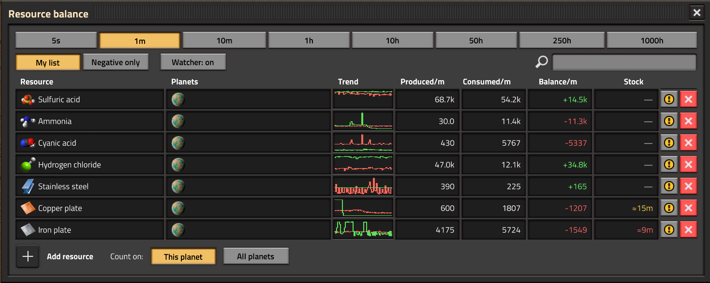
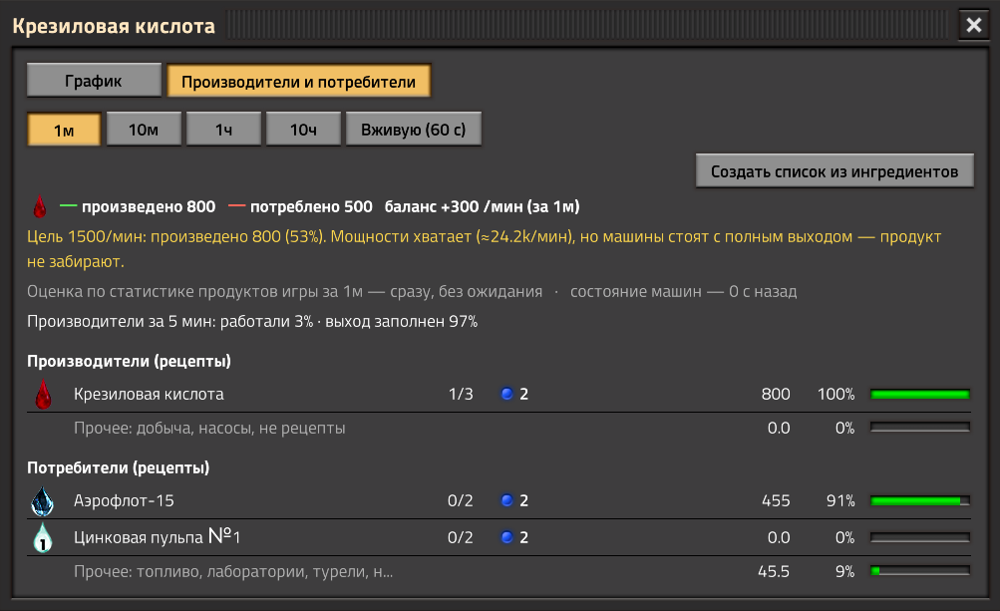
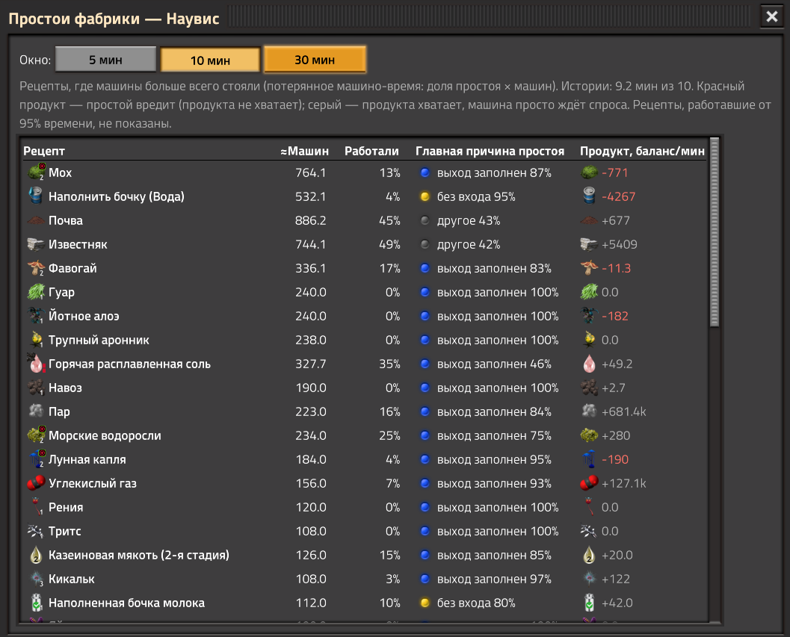
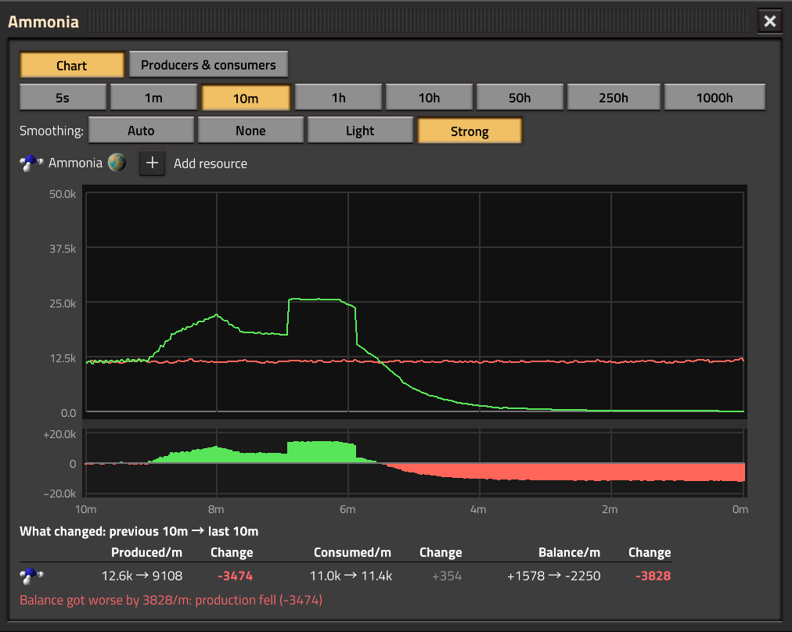
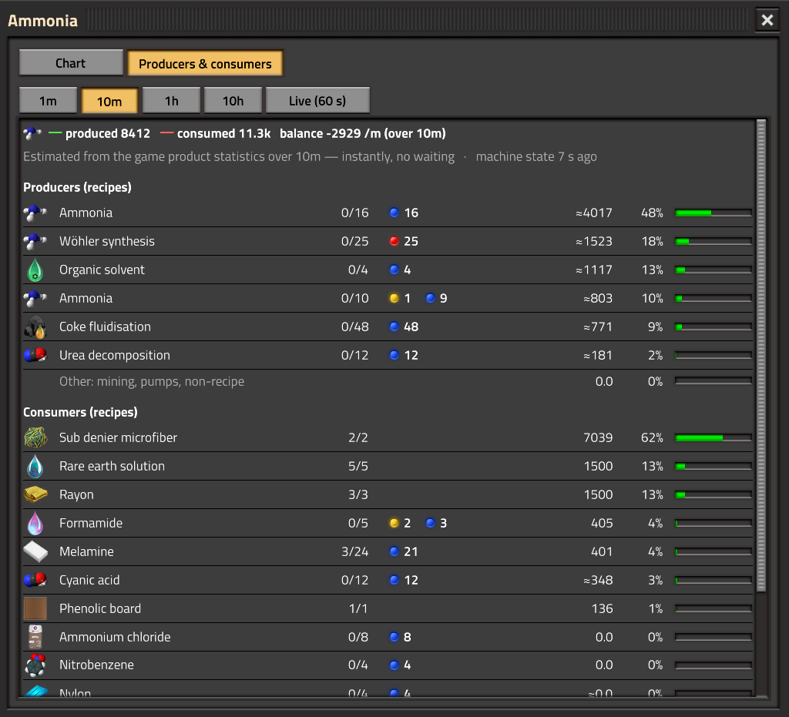
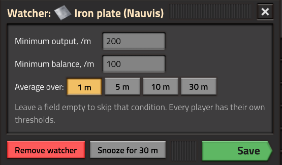

# Resource Balance

A Factorio mod: a floating panel that shows **produced, consumed and balance per minute** for the items and fluids
you pick — per planet or summed over all planets and space platforms. Made for big overhauls like Pyanodon's,
where a deficit deep in a long production chain is hard to spot.

**Mod portal:** https://mods.factorio.com/mod/resource-balance · Factorio 2.1 (the last version for 2.0 is 1.3.0)

## Features

- **My list** of resources, each bound to its planet or summed over all planets (Σ), with trend charts,
  search and sorting; **Negative only** mode lists every deficit on the current planet.
- **Several lists** as tabs, with **export / import** as a text string.
- **Stock** column: how long the stock lasts at the current deficit — items in logistic networks, fluids in
  storage tanks.
- **Large chart** with smooth lines, a balance band, values on hover, event **marks** and comparison of up to 4 resources.
- **What changed**: the previous period against the last one, with a verdict — did production fall or
  consumption rise, or did the line stop completely.
- **Producers & consumers** per recipe, with machine status counters (missing ingredients, output full,
  no power or fuel); click a counter to jump to the next such machine on the map. For a deficit it hints at
  the cause: ingredients that are short too, or producers standing with a full output (a delivery problem).
- **Watcher**: thresholds for minimum output and minimum balance, averaged over 1–30 minutes; a red bell and
  a counter on the mod button, optional chat message and sound, pause per list and snooze; a **log** of alerts
  and automatic **marks** on the chart.
- **Output targets**: "produced" turns yellow below the target, and a verdict says whether machine capacity,
  ingredients or output removal is the limit (with an estimate of machines to add).
- **Diagnostics for long chains**: background **machine state history** (working / no input / output full /
  power over the last 30 minutes), the **byproduct** that clogs a line, a **root cause** tree, a factory-wide
  **idle** view, and recognising a **full storage** (city blocks, trains) instead of a false deficit.
- **Fluid stock** in storage tanks, **Alt+R** to add what is under the cursor, **list from ingredients**,
  quality (Space Age) counted as a sum of all qualities.

## Usage

Open the panel with **Ctrl+Shift+R**, the shortcut bar button or the button at the top left.
Click a resource to open its chart; Ctrl+click or right-click adds it to the open chart.

## Languages

English, Ukrainian, Russian. Translations are welcome — `locale/<language>/locale.cfg`.

## License

[MIT](LICENSE) © Yuliy Shcherbak
