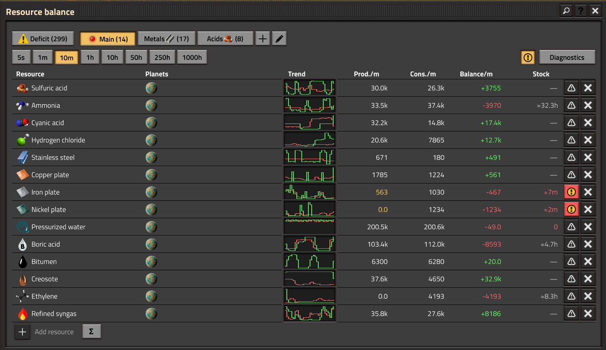
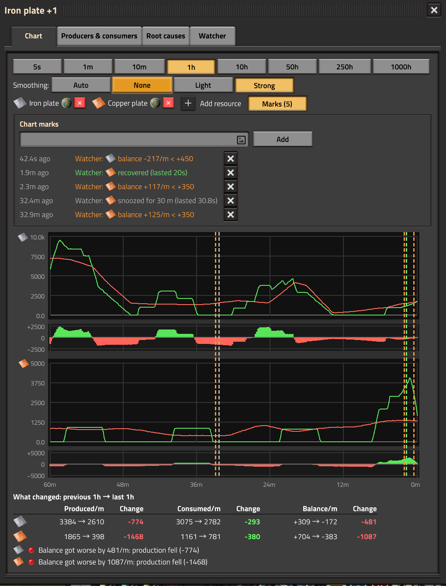
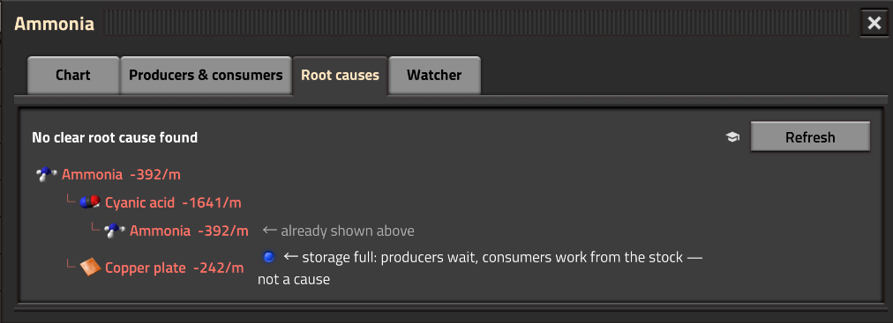
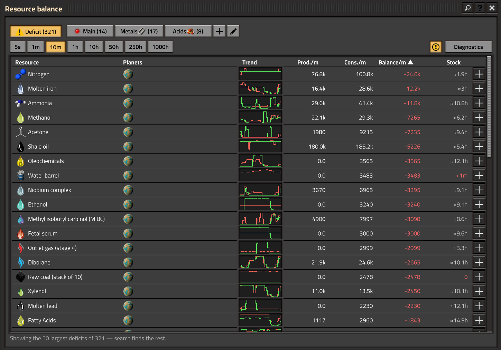
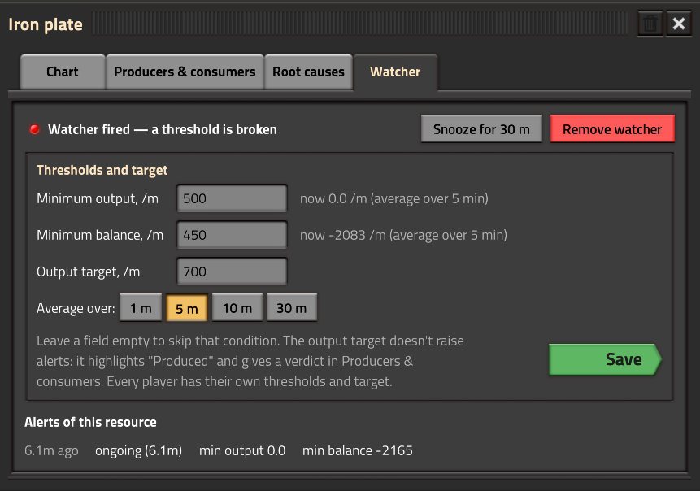
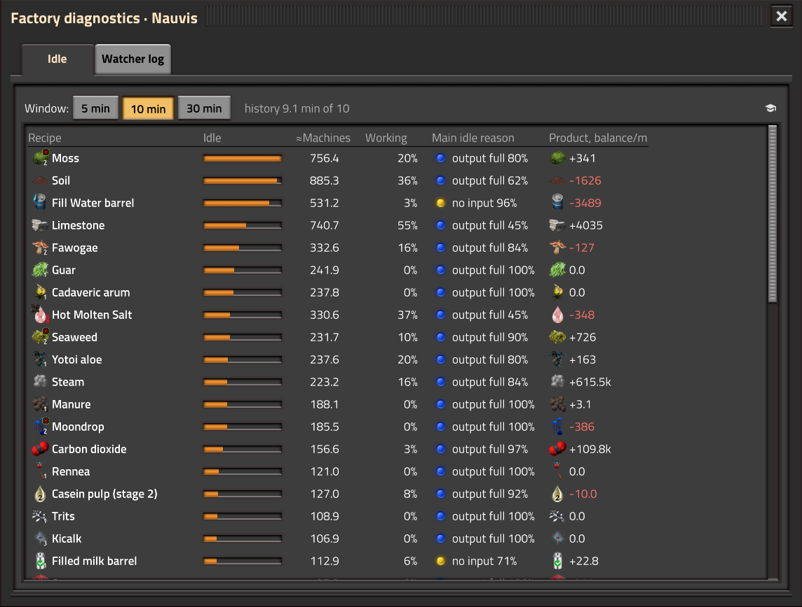
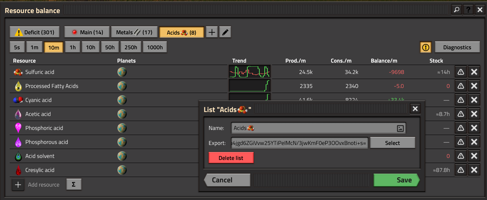
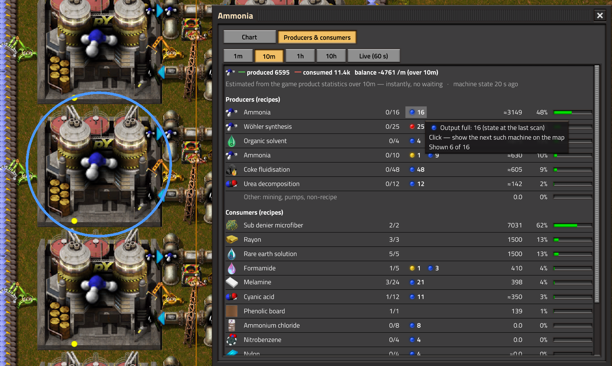

# Resource Balance

A Factorio mod: a floating panel that shows **produced, consumed and balance per minute** for the items and fluids
you pick — per planet or summed over all planets and space platforms. Made for big overhauls like Pyanodon's,
where a deficit deep in a long production chain is hard to spot.

**Mod portal:** https://mods.factorio.com/mod/resource-balance · Factorio 2.1 (the last version for 2.0 is 1.3.0)

## Features

- **Lists** of resources as tabs, each resource bound to its planet or summed over all planets (Σ), with trend
  charts, search and sorting; **export / import** a list as a text string.
- **Deficit** tab: everything in the negative on the current planet, largest first; add any of it to a list.
- **Stock** column: how long the stock lasts at the current deficit — items in logistic networks, fluids in
  storage tanks.
- **Resource window** with four tabs:
  - **Chart** — smooth lines, a balance band, values on hover, event **marks**, comparison of up to 4 resources
    and **what changed** between the previous and the last period;
  - **Producers & consumers** — a diagnosis card on top, then every recipe with machines, status counters (click
    one to jump to such a machine on the map), background state history and share;
  - **Root causes** — a tree of short ingredients down the chain with a reason at every branch end;
  - **Watcher** — minimum output / balance thresholds averaged over 1–30 minutes, an output target, and the
    alert log of this resource.
- **Diagnostics for long chains**: machine state history (working / no input / output full / power over the last
  30 minutes), the **byproduct** that clogs a line, recognising a **full storage** (city blocks, trains) instead
  of a false deficit, and a target verdict with an estimate of machines to add.
- **Diagnostics window**: the recipes on the planet that stand still the most, and the watcher log.
- **Ctrl+Alt+R** to add what is under the cursor, **list from ingredients**, quality (Space Age) counted as a sum
  of all qualities.

## Usage

Open the panel with **Ctrl+Shift+R**, the shortcut bar button or the button at the top left.
Click a resource to open its window; Ctrl+click or right-click adds it to the open chart.
The **?** button in the panel title lists all controls.

## Languages

English, Ukrainian, Russian. Translations are welcome — `locale/<language>/locale.cfg`.

## License

[MIT](LICENSE) © Yuliy Shcherbak
